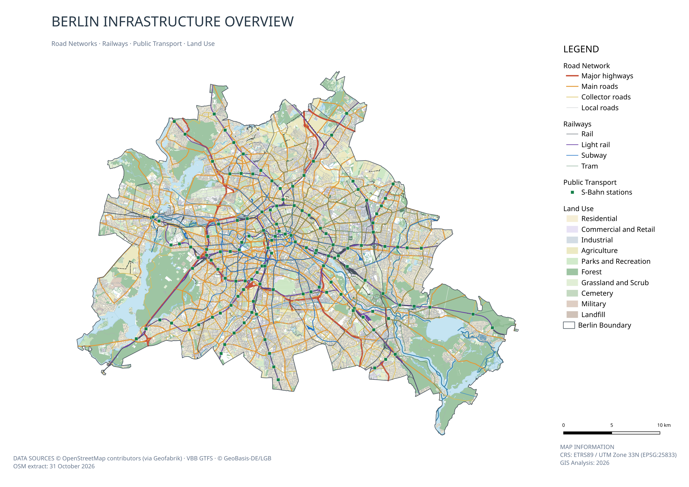
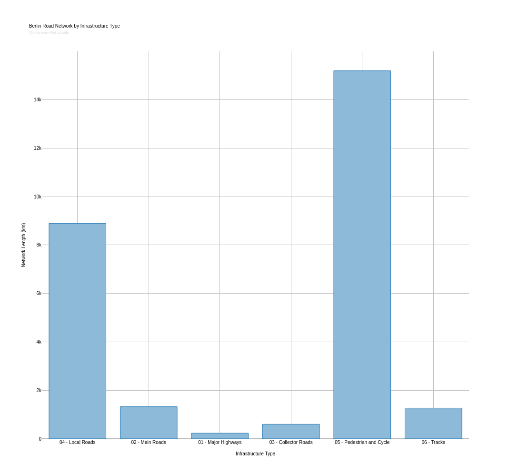
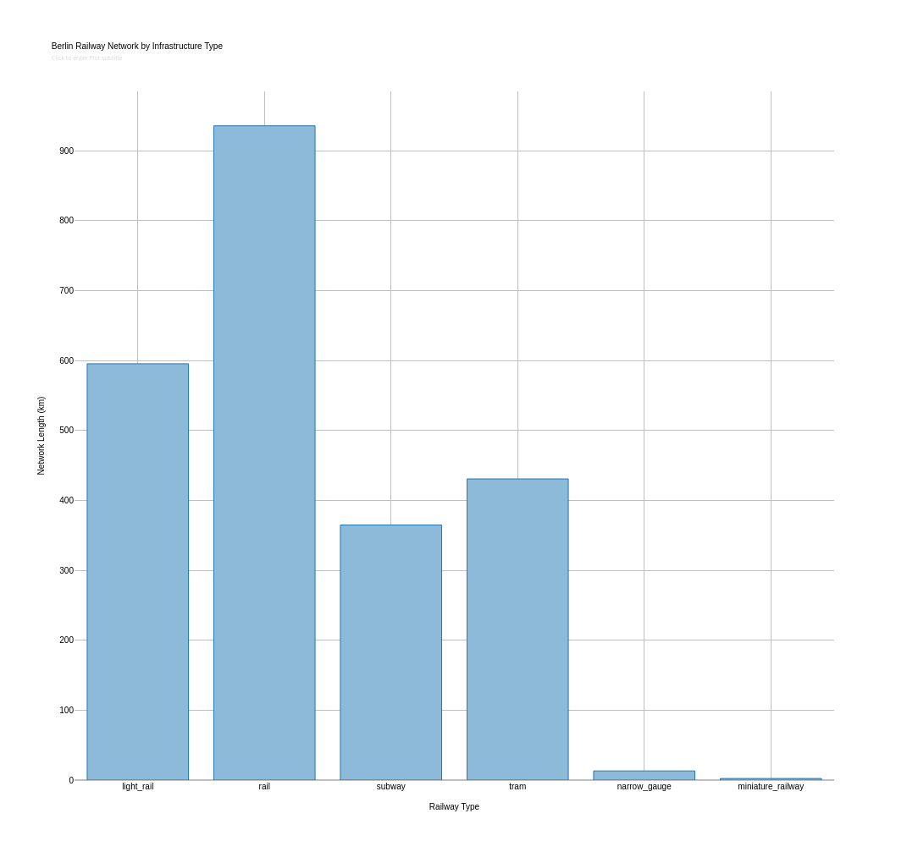
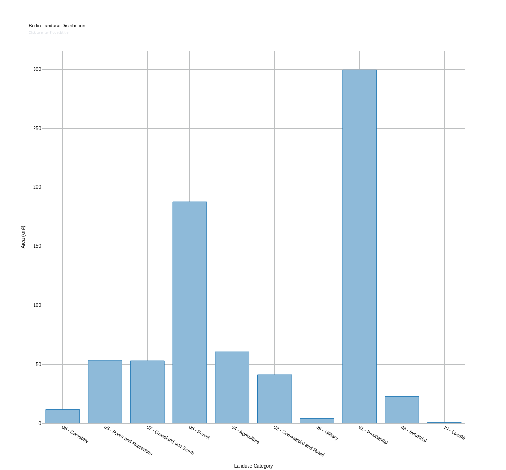
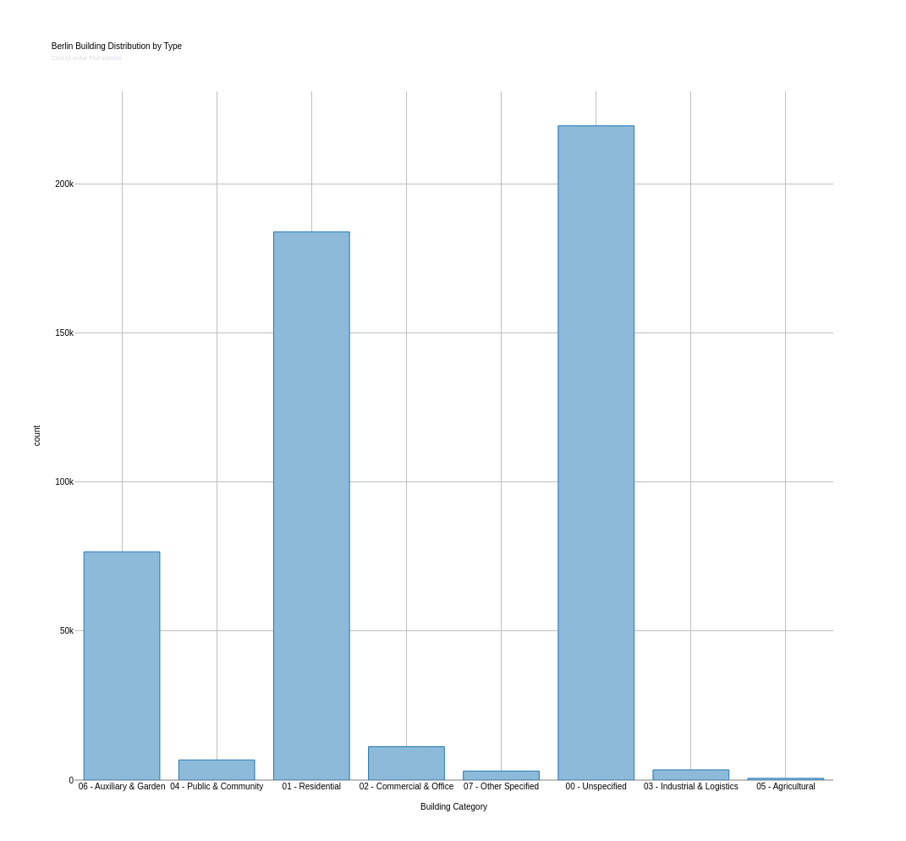

# Berlin Infrastructure GIS Atlas

**A QGIS portfolio project exploring Berlin's roads, railways, public transport, land use, and building footprints using open geospatial data.**

This project demonstrates an end-to-end desktop GIS workflow: importing source data, working with coordinate reference systems, clipping features to an administrative boundary, calculating geometry-based statistics, validating geometries, and designing print-ready thematic maps.

**Study area:** Berlin, Germany  
**Project CRS:** ETRS89 / UTM zone 33N (`EPSG:25833`)  
**Software:** QGIS 4.2, GTFS-GO, Data Plotly  
**OSM extract:** 31 October 2026



*Berlin Infrastructure Overview — QGIS cartography based on OpenStreetMap, VBB and official administrative boundary data.*

## Maps

| Map | Focus | PDF |
| --- | --- | --- |
| Infrastructure Overview | Roads, railways, public transport, land use, and water | [Open PDF](outputs/maps/berlin_infrastructure_overview.pdf) |
| Transportation Network | Road and rail networks, with a 1:25,000 inset of central Berlin | [Open PDF](outputs/maps/berlin_transportation_network.pdf) |
| Urban Landuse & Environment | Land-use patterns, green areas, waterways, and a data-linked statistics table | [Open PDF](outputs/maps/berlin_urban_landuse.pdf) |

All three maps were composed in **QGIS Print Layout**. The layouts use map themes to preserve different layer combinations within one project.

## Analysis results

### 1. Road network

Road features were clipped to the Berlin boundary, reprojected to `EPSG:25833`, measured in kilometres, and grouped into six infrastructure classes.

| Road group | Mapped line length (km, approx.) |
| --- | ---: |
| Pedestrian & cycle | 15,193 |
| Local roads | 8,894 |
| Main roads | 1,324 |
| Tracks | 1,268 |
| Collector roads | 602 |
| Major highways | 232 |
| **Total** | **27,512** |

**453,102** line features were included.



### 2. Railway network

**10,894** clipped railway line features were classified by the OSM `fclass` attribute.

| Railway class | Mapped line length (km, approx.) |
| --- | ---: |
| Rail | 935.86 |
| Light rail | 595.52 |
| Tram | 430.80 |
| Subway | 364.88 |
| Narrow gauge | 13.11 |
| Miniature railway | 2.27 |
| **Total** | **2,342.44** |



### 3. Land use

**50,615** clipped land-use polygons were grouped into ten categories. Their measured areas were summarized in QGIS.

| Land-use group | Summed polygon area (km², approx.) |
| --- | ---: |
| Residential | 299.55 |
| Forest | 187.44 |
| Agriculture | 60.42 |
| Parks & recreation | 53.32 |
| Grassland & scrub | 52.83 |
| Commercial & retail | 40.84 |
| Industrial | 22.69 |
| Cemetery | 11.47 |
| Military | 3.86 |
| Landfill | 0.67 |
| **Total** | **733.09** |

The land-use print layout includes a **QGIS Attribute Table item linked to the statistics GeoPackage**, rather than manually typed results.



### 4. Building footprints

**504,839** clipped building polygons were measured in square metres and classified into eight groups using the OSM `type` field.

- Total **summed building footprint area:** approximately **102.44 km²**.
- **219,416 polygons (about 43.5%)** had no specific building type; they were kept in an *Unspecified* category.
- Residential buildings accounted for approximately **43.67 km²** of summed footprint area.



## Methodology

1. **Data preparation:** Import Geofabrik Berlin OSM data, VBB GTFS transit data, and an official Berlin administrative boundary.
2. **CRS handling:** Use the original source CRS for raw datasets and reproject analytical outputs to `EPSG:25833` (metres).
3. **Spatial processing:** Clip roads, railway lines, land-use polygons, and building footprints to Berlin's boundary.
4. **Attribute analysis:** Calculate lengths and areas using QGIS Field Calculator; group source classes with `CASE` expressions and aggregate them using *Statistics by categories*.
5. **Cartography:** Apply categorized/rule-based symbology, scale-dependent visibility, GTFS-based station markers, and QGIS map themes.
6. **Layout & export:** Produce three A3 maps with legends, scale bars, source acknowledgements, and a central-Berlin inset map.
7. **Quality control:** Run the GEOS *Check validity* algorithm on processed polygon layers.

### Geometry validation

| Layer | Valid polygons | Invalid | Errors |
| --- | ---: | ---: | ---: |
| Berlin land use | 50,615 | 0 | 0 |
| Berlin buildings | 504,839 | 0 | 0 |

These checks establish the validity of **individual feature geometries**. They do **not** establish that different features never overlap or that the source data are complete.

## Repository structure

```text
.
├── project/
│   └── infrastructure_gis_atlas.qgz
├── data/
│   ├── raw/                  # Source downloads; not committed
│   └── processed/            # Derived GeoPackages and selected tables
├── outputs/
│   ├── maps/                 # Three final PDF maps
│   └── charts/               # Four analysis charts
├── .gitignore
└── README.md
```

### Opening the QGIS project

Open `project/infrastructure_gis_atlas.qgz` in QGIS. The project uses **relative paths** so its directory can be moved as a unit.

**Important data availability note:** Two large derived GeoPackages — `data/processed/berlin_roads.gpkg` and `data/processed/berlin_buildings.gpkg` — are excluded from the Git repository due to their size. They must be placed at these exact relative paths before the complete interactive QGIS project can render. Separate download distribution is planned; **the files are not yet included with this repository**. The original `data/raw/` downloads are also excluded. Other source-dependent layers or auxiliary tables may need to be restored if QGIS reports missing sources.

The PDF maps and PNG charts in `outputs/` can be viewed without QGIS or the source GeoPackages.

## Data sources and attribution

- **OpenStreetMap contributors** — Berlin OSM data distributed by [Geofabrik](https://download.geofabrik.de/europe/germany/berlin.html). OSM-derived data are subject to the [Open Database License (ODbL 1.0)](https://opendatacommons.org/licenses/odbl/1-0/). © OpenStreetMap contributors.
- **VBB Verkehrsverbund Berlin-Brandenburg GmbH** — [VBB GTFS transit data](https://unternehmen.vbb.de/digitale-services/datensaetze/), provided under Creative Commons Attribution according to the [Berlin Open Data catalogue](https://daten.berlin.de/datensaetze/vbb-fahrplandaten-via-gtfs). Attribution: VBB Verkehrsverbund Berlin-Brandenburg GmbH.
- **GeoBasis-DE/LGB** — official Berlin administrative boundary via [LGB administrative boundaries](https://geobasis-bb.de/lgb/de/geodaten/weitere-digitale-produkte/digitale-verwaltungsgrenzen/), licensed under [Datenlizenz Deutschland – Namensnennung 2.0](https://www.govdata.de/dl-de/by-2-0). Attribution: © GeoBasis-DE/LGB, dl-de/by-2-0 (data processed).

The source datasets retain their respective licences; inclusion in this portfolio does not replace those licences.

## Interpretation and limitations

- All reported road and railway figures are **sums of mapped OSM line-feature lengths**, not official route-kilometre or road-centreline statistics. Separate carriageways, tracks, and mapped paths can contribute independently.
- The land-use total is a **sum of polygon areas**, not necessarily the unique covered area or a percentage of Berlin's administrative area; OSM polygons can overlap or leave gaps.
- Building totals refer to **mapped polygons**, not verified counts of distinct physical buildings. Footprint areas are not usable floor areas.
- VBB stop display is simplified for cartographic clarity, and some stop/platform duplicates or classification ambiguities may remain.
- Results represent a particular data extract and processing workflow, not a live or authoritative municipal dataset.

## Project scope

This is a **QGIS-first, no-code GIS portfolio exercise** focusing on reproducible desktop GIS skills, analytical interpretation, and professional map design. Further improvements could include overlap checks, a fully packaged data release, and a documented end-to-end reproduction procedure.
